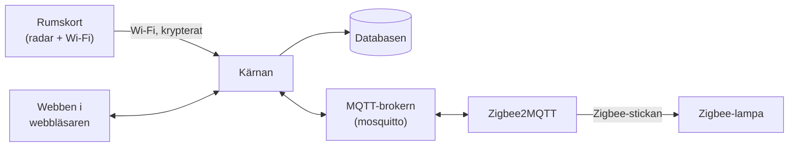

# Installera Homecontrol från noll

Den här guiden tar dig från en tom dator till ett rum där lampan tänds när
du går in. Den är skriven för dig som inte kodar men vill förstå vad som
händer. Varje steg har tre delar:

- **Gör så här:** exakt vad du gör, med kommandon att kopiera.
- **Vad händer?** en kort förklaring av vad som sker bakom kulisserna.
- **Kontrollera:** hur du ser att det fungerade innan du går vidare.

Ta ett steg i taget. Fungerar inte kontrollen: stanna där och läs
felsökningen i den länkade guiden, innan du går vidare.

> Projektet är under arbete och provas just nu i ett rum. Räkna med att
> något kan behöva justeras.

## Innehåll

1. [Översikt: vad är delarna?](#1-översikt-vad-är-delarna)
2. [Förbered Windows](#2-förbered-windows)
3. [Hämta Homecontrol (klona repot)](#3-hämta-homecontrol-klona-repot)
4. [Inställningsfilen .env](#4-inställningsfilen-env)
5. [Starta allt med docker compose](#5-starta-allt-med-docker-compose)
6. [Öppna webben](#6-öppna-webben)
7. [Installera det första rumskortet](#7-installera-det-första-rumskortet)
8. [Koppla Zigbee-lampan](#8-koppla-zigbee-lampan)
9. [Rita rummet på kartan](#9-rita-rummet-på-kartan)
10. [Se närvaro live](#10-se-närvaro-live)
11. [Vad du lärt dig](#vad-du-lärt-dig)
12. [Nästa steg](#nästa-steg)

## 1. Översikt: vad är delarna?

Homecontrol är flera små program som pratar med varandra. Tänk dig ett
litet kontor:

| Del | Vad den gör | Liknelse |
| --- | --- | --- |
| **Rumskortet** (ESP32 med radar) | Sitter i rummet och känner av var människor är. Skickar det över Wi-Fi. | Vakten som tittar ut i rummet. |
| **Kärnan** (`core`) | Tar emot allt från korten, räknar ut var någon är och bestämmer vilka lampor som ska vara tända. | Chefen som fattar besluten. |
| **Databasen** (`db`, PostgreSQL med TimescaleDB) | Sparar hemmets karta och historiken. | Arkivskåpet. |
| **MQTT-brokern** (`mosquitto`) | Skickar meddelanden mellan kärnan och Zigbee2MQTT. | Postkontoret. |
| **Zigbee2MQTT** (`zigbee2mqtt`) | Pratar med lamporna via Zigbee-stickan och översätter till MQTT. | Tolken som kan lampornas språk. |
| **Webben** | Sidan i webbläsaren där du ritar hemmet och ser vad som händer. Kärnan visar den. | Kontorets anslagstavla. |

Några ord som kommer tillbaka:

- **Zigbee** är ett trådlöst språk som smarta lampor talar. Datorn talar
  det inte själv, därför behövs en **Zigbee-sticka** (en USB-sticka med
  radio).
- **MQTT** är ett enkelt sätt för program att skicka korta meddelanden
  till varandra, via en **broker** (ett postkontor) som delar ut dem.
- **Docker** kör varje program i en egen **container**: en låda med
  programmet och allt det behöver. Lådorna startas med ett enda kommando.

Så här hänger det ihop:



Samma sak i text:

```text
Rumskort --Wi-Fi--> Kärnan <--> MQTT-brokern <--> Zigbee2MQTT --Zigbee--> Lampa
                      |  \
                Databasen  Webben (i din webbläsare)
```

Allt körs på din egen dator. Inget skickas till molnet.

## 2. Förbered Windows

**Gör så här:** följ [WINDOWS.md](WINDOWS.md) steg 1–6. Den visar
exakt vilka kommandon du skriver. Har du redan en Linuxdator med Docker kan
du hoppa till steg 3 här.

**Vad händer?**

- **WSL** (Windows Subsystem for Linux) kör Ubuntu, en variant av Linux,
  som en liten dator inuti Windows. Homecontrol är byggt för Linux, ungefär
  som en apparat byggd för ett visst eluttag; WSL är adaptern.
- **Docker** installeras i Ubuntu och kör Homecontrols program i
  containrar. Då behöver du inte installera varje program för sig.
- **Mirrored-läget** gör att Ubuntu delar Windows nätverkskort. Utan det
  skulle rumskorten och mobilen inte hitta Homecontrol i hemnätet.
- **usbipd** lånar ut Zigbee-stickan från Windows till Ubuntu, eftersom
  Ubuntu inte ser USB-enheter av sig själv.

**Kontrollera:** i fönstret Ubuntu ska

```sh
docker run --rm hello-world
```

skriva ut **Hello from Docker!**. Och med Zigbee-stickan inkopplad ska
`ls /dev/serial/by-id/` visa ett långt namn för stickan.

## 3. Hämta Homecontrol (klona repot)

**Gör så här:** i Ubuntu:

```sh
sudo apt install git
git clone https://github.com/YXHFR/Homecontrol.git
cd Homecontrol
```

**Vad händer?** **Git** är ett program som håller reda på alla versioner
av koden. **Klona** betyder att hämta en egen kopia av hela projektet (ett
**repo**, förkortning av repository, "förråd") från GitHub till din dator.
Mappen `Homecontrol` innehåller nu allt: kärnan, webben, firmware och
inställningarna för Docker.

**Kontrollera:**

```sh
ls
```

ska visa bland annat `compose.yaml`, `core`, `web` och `firmware`.

Senare hämtar du nya versioner med `git pull` i samma mapp.

## 4. Inställningsfilen .env

**Gör så här:** i Ubuntu, i mappen `Homecontrol`:

```sh
cp .env.example .env
nano .env
```

Byt ut varje `byt-mig` mot ett eget lösenord, ett nytt för varje rad.
Skapa lösenord med:

```sh
openssl rand -hex 24
```

Kör kommandot en gång för varje lösenord och kopiera svaret. I `nano`
sparar du med Ctrl+O och Enter och stänger med Ctrl+X.

**Vad betyder raderna?**

| Inställning | Betyder |
| --- | --- |
| `POSTGRES_PASSWORD` | Databasens huvudlösenord. Används bara när databasen förbereds. Byt det inte efter första starten. |
| `CORE_DATABASE_PASSWORD` | Kärnans eget lösenord till databasen. Kärnan får bara läsa och skriva, inte ändra databasen. |
| `MQTT_CORE_PASSWORD`, `MQTT_ZIGBEE2MQTT_PASSWORD` | Lösenorden till postkontoret (MQTT), ett för kärnan och ett för Zigbee2MQTT. Var och en får bara läsa de meddelanden den behöver. |
| `ZIGBEE2MQTT_AUTH_TOKEN` | Lösenordet du loggar in med på Zigbee2MQTT:s egen webbsida (steg 8). Spara det. |
| `ESPHOME_SECRET` | Hemligheten som varje rumskorts nyckel räknas fram ur. Skapa den med `openssl rand -hex 32` när du har ett rumskort. **Byt den aldrig sedan**: då måste alla kort installeras om. Tom betyder simuleringsläge, utan riktiga kort. |
| `ZIGBEE_ADAPTER` | Var Zigbee-stickan finns, hela namnet från `ls /dev/serial/by-id/` (se WINDOWS.md steg 6). Tom om du inte har någon sticka än. |

Resten av filen är valfritt och kan stå som det är.

**Vad händer?** `.env` är Homecontrols inställningsfil. Docker läser den
när programmen startar och ger varje program de lösenord det behöver.
Filen finns bara på din dator; den följer aldrig med till GitHub (den är
**gitignorerad**, alltså undantagen från git).

**Kontrollera:**

```sh
grep byt-mig .env
```

ska inte skriva ut något. Gör den det finns rader kvar att fylla i.

## 5. Starta allt med docker compose

**Gör så här:** i Ubuntu, i mappen `Homecontrol`:

```sh
docker compose up -d
```

Första gången hämtas programmen från nätet. Det tar några minuter.

**Vad händer?** `docker compose` läser filen `compose.yaml`, som är en
lista över alla containrar och hur de hänger ihop. `up` startar dem, och
`-d` betyder att de körs i bakgrunden, så att du kan stänga fönstret. De
startar också av sig själva efter en omstart.

| Container | Vad den gör |
| --- | --- |
| `db` | Databasen. Nås bara av kärnan, inte från nätverket. |
| `db-setup` | Förbereder databasens tabeller och kärnans inloggning, och avslutas sedan. Det är meningen att den står som stoppad (**Exited (0)**). |
| `core` | Kärnan och webben, på port 8000. |
| `mosquitto` | MQTT-brokern, på port 1883. |
| `zigbee2mqtt` | Pratar med Zigbee-stickan. Egen webbsida på port 8080. |

En **port** är ett nummer som säger vilket program på datorn du vill
prata med, ungefär som ett rumsnummer i en korridor.

**Kontrollera:**

```sh
docker compose ps
```

`core`, `db`, `mosquitto` och `zigbee2mqtt` ska ha **Up** i kolumnen
STATUS (gärna med **(healthy)**). Står något som **Restarting** eller
saknas: titta i loggen med `docker compose logs core` (byt `core` mot
containerns namn).

## 6. Öppna webben

**Gör så här:** öppna <http://localhost:8000> i webbläsaren på samma
dator. Från mobilen i hemnätet: `http://<datorns adress>:8000` (se
WINDOWS.md steg 7 för hur du hittar adressen).

**Vad händer?** Kärnan är också en liten webbserver. Sidan i webbläsaren
får en ström av händelser från kärnan, så att kartan uppdateras direkt när
något händer, utan att du laddar om.

**Kontrollera:**

- Överst på sidan står **Homecontrol**, och bredvid det **hälsoraden**. Den
  ska visa **Allt fungerar** (eller **Zigbee-stickan svarar inte** om du
  inte har kopplat in någon sticka än).
- Du ser en karta. Är hemmet tomt står det **Hemmet har inga rum än** och
  en knapp **Ändra rummet**.
- Står **Simulering** överst och har kartan en randig kant är
  **simuleringen** på: Homecontrol låtsas att det finns rumskort, så att du
  kan prova allt utan hårdvara. Knappen **Sim** slår på och av den.

Prova gärna simuleringen nu: tryck på **+ Person** och dra personen in i
ett rum. Rummet blir **upptaget** och lampan tänds om det är mörkt (dra
reglaget **Dagsljus** åt vänster).

## 7. Installera det första rumskortet

Rumskortet är ett litet kretskort (ESP32-S3) med en radar. Det behöver
**firmware**, programmet som körs på kortet. Den läggs på över USB med
**webbinstalleraren**, en webbsida som du startar på din egen dator.

### 7a. Ge kärnan en hemlighet för korten

**Gör så här:** i Ubuntu, i mappen `Homecontrol`:

```sh
openssl rand -hex 32
nano .env
```

Klistra in svaret efter `ESPHOME_SECRET=`, spara (Ctrl+O, Enter) och stäng
(Ctrl+X). Starta sedan om det som ändrats:

```sh
docker compose up -d
```

**Vad händer?** Kärnan och varje kort pratar krypterat, med en nyckel per
kort. Nyckeln räknas fram ur hemligheten och kortets namn, ungefär som en
nyckelsmed som kan göra en ny nyckel till varje dörr utifrån en
huvudnyckel. Kortet får sin nyckel första gången kärnan ansluter. `docker
compose up -d` startar om bara de containrar vars inställningar har ändrats.

**Kontrollera:** `grep ESPHOME_SECRET .env` visar en lång rad med siffror
och bokstäver efter `=`.

### 7b. Lägg firmware på kortet

**Gör så här:** följ [firmware/README.md, avsnittet
Installera](firmware/README.md#installera), steg 1–6. I korthet:

1. GitHub → **Actions** → **Firmware** → den senaste gröna körningen på
   **main** → **Artifacts** → **webbinstallerare** (du måste vara inloggad).
2. Packa upp zip-filen (**Extrahera alla…**).
3. Dubbelklicka på **`starta.bat`** i mappen. Edge öppnar
   <http://localhost:8765>.
4. Välj rum och radar, anslut kortet med USB-C, klicka på **CONNECT**,
   välj kortets port och klicka på **Anslut**.
5. **INSTALL HOMECONTROL …** → kryssa i **Erase device** → **NEXT** →
   **INSTALL**. Vänta tills det står **Installation complete!**
6. Ange Wi-Fi-nätverk och lösenord när sidan frågar (Improv) och klicka på
   **CONNECT**.

**Vad händer?**

- `starta.bat` startar en liten webbserver som bara din egen dator når.
  Webbläsaren litar på `localhost`, och därför får sidan prata med USB
  (det kallas **Web Serial**). Det fungerar i Chrome och Edge, inte i
  Firefox eller Safari.
- Sidan skickar firmware-filen till kortet över kabeln, som att skriva en
  ny bok på ett tomt block. **Erase device** suddar först ut allt gammalt.
- **Improv** är ett sätt att ge kortet Wi-Fi-lösenordet över kabeln i
  stället för att skriva in det i firmware. Lösenordet stannar på kortet.
- Kortet hämtar aldrig något från internet. En ny version installerar du
  på samma sätt, över USB, med **Erase device** tom.

**Kontrollera:** efter en halv minut visar hälsoraden i Homecontrol
**+1 ny enhet**. Tryck på den: kortet står som **Nytt rumskort hittat ·
inte placerat**. Det placerar du på kartan i steg 9.

Syns kortet inte i webbinstalleraren: se
[Felsökning](firmware/README.md#felsökning) (datakabel, knappen **BOOT** på
ESP32-S3-Zero, drivrutin, porten upptagen).

## 8. Koppla Zigbee-lampan

Lamporna kopplas i **Zigbee2MQTT:s egen webbsida**, inte i Homecontrol.
Det är med flit: kärnan får styra lamporna men inte släppa in nya enheter i
Zigbee-nätet.

**Gör så här:**

1. Öppna <http://localhost:8080> och logga in med lösenordet
   `ZIGBEE2MQTT_AUTH_TOKEN` från `.env`.
2. Första gången visar Zigbee2MQTT en guide. Välj din Zigbee-stickas typ
   och port (porten är redan ifylld som `/dev/zigbee`) och spara.
3. Klicka på knappen för att släppa in enheter, överst på sidan (på
   engelska **Permit join (All)**). Den är öppen i några minuter.
4. Sätt lampan i parkopplingsläge. Det står i lampans manual; ofta tänder
   och släcker man den 5–6 gånger i rad tills den blinkar.
5. Vänta tills lampan syns i listan **Devices** i Zigbee2MQTT. Ge den
   gärna ett namn du känner igen, till exempel `Taklampa kök`.
6. Klicka på samma knapp igen för att stänga för nya enheter.

**Vad händer?** Zigbee-nätet är som en klubb med dörrvakt. **Permit join**
öppnar dörren en stund så att lampan får komma in och får en egen adress.
Sedan skickar Zigbee2MQTT lampans läge som meddelanden till MQTT-brokern,
och kärnan läser dem där. När kärnan vill tända lampan skickar den ett
meddelande tillbaka samma väg.

**Kontrollera:** i Homecontrol visar hälsoraden **+1 ny enhet** (eller
**+2 nya enheter** tillsammans med rumskortet), och lampan står som **Ny
lampa hittad · inte placerad**.

## 9. Rita rummet på kartan

**Gör så här:**

1. Tryck på **Ändra rummet**. Överst står nu **Ändrar rummet** och en
   knapp **Klar**.
2. Under **Rita**: välj **Rum, rektangel**. Tryck där ett hörn av rummet
   är och dra till hörnet snett emot. Släpp.
   (Med **Rum, fri form** klickar du på varje hörn och till sist på det
   första hörnet igen.)
3. Rummet är valt. Skriv rummets namn i rutan **Namn** under **Valt på
   kartan** och tryck Enter.
4. Har du en planritning: **Ladda upp bild** under **Planritning**, och
   sedan **Skala bilden**. Klicka på två punkter vars avstånd du vet, skriv
   avståndet under **Avstånd i meter** och tryck på **Skala**. Då blir
   måtten rätt.
5. Under **Placera** står **Nya rumskort som kärnan har hittat:** och
   **Nya lampor som kärnan har hittat:**. Klicka på **Placera
   homecontrol-…** och sedan på lampans **Placera …**.
6. Välj **Välj och flytta** och dra kortet och lampan dit de sitter i
   verkligheten. Vrid kortet med ringen så att det pekar dit radarn
   tittar.
7. Exempelhemmets rum behöver du inte: välj dem och tryck på **Ta bort
   rummet**.
8. Tryck på **Klar**.

**Vad händer?** Kartan är kärnans bild av hemmet. Den sparas i databasen
direkt när du ändrar något. Radarn säger bara "en person står 2 meter
framför mig och 1 meter till vänster". Med kortets läge och riktning på
kartan räknar kärnan om det till en plats i rummet, ungefär som att läsa en
vägbeskrivning utifrån var någon står och åt vilket håll den tittar.

När kortet placeras ansluter kärnan till det och ger det dess nyckel.
Placera därför kortet så snart det har fått Wi-Fi.

**Kontrollera:**

- Under verktygen står **Alla ändringar är sparade.**
- Hälsoraden visar **Allt fungerar** och inte längre **ny enhet**.
- Ladda om sidan: rummet, kortet och lampan finns kvar.

## 10. Se närvaro live

**Gör så här:**

1. Stäng av simuleringen om den är på: tryck på **Sim** så att
   **Simulering** försvinner överst.
2. Gå in i rummet.
3. Titta på kartan.

**Vad händer?** Radarn mäter ungefär 10 gånger i sekunden var personer är
och skickar det till kärnan. Kärnan lägger ihop det med Wi-Fi-rörelsen
(**CSI**, hur Wi-Fi-signalen störs när någon rör sig) och bestämmer om
rummet är upptaget. Är det mörkt tänds lampan; när rummet har varit tomt en
stund släcks den. Webbsidan får varje ändring direkt från kärnan.

**Kontrollera:**

- En **fylld prick** följer dig på kartan. En **streckad ring** betyder att
  radarn har tappat dig en kort stund men att kärnan minns var du var.
- Rummets kort visar **upptaget**, och lampan tänds om det är mörkt.
  Rummet står kvar som upptaget ungefär 10 sekunder efter att du gått ut.
- Hamnar pricken på fel sida om kortet: öppna kortets kort → **Fler
  inställningar** → kryssa i **Spegelvänd sidled**.
- Tänder du lampan för hand i dess kort står det **Manuellt läge**.
  **Automatik igen** lämnar tillbaka den till Homecontrol.

Vill du att lampan tänds vid rätt ljusnivå: tryck på **Mät lampornas
ljus** i rummets kort och sedan **Starta kalibreringen**. Kärnan tänder och
släcker lamporna och mäter med kortets ljussensor hur mycket ljus var och
en ger.

## Vad du lärt dig

- Homecontrol är flera små program i **containrar** som startas med
  `docker compose up -d` och pratar med varandra.
- **Kärnan** fattar besluten, **databasen** minns, **MQTT-brokern** delar
  ut meddelanden och **Zigbee2MQTT** pratar med lamporna.
- `.env` håller alla lösenord och stannar på din dator.
- Rumskorten får firmware över **USB** med webbinstalleraren som du kör
  lokalt, och Wi-Fi med **Improv**. De hämtar inget från internet.
- Kartan kopplar ihop radarns mätningar med verkliga platser i hemmet.
- Du kan alltid kontrollera läget med `docker compose ps` och hälsoraden.

## Nästa steg

- **Fler rum:** ett rumskort per rum. Upprepa steg 7b och 9.
- **Zoner:** rita till exempel en **Stillhetszon** vid soffan under
  **Zoner** i **Ändra rummet**, så att lampan inte släcks när du sitter
  still.
- **Inställningar för rummet:** välj rummet i **Ändra rummet**. Där
  ställer du in när lampan tänds och släcks, till exempel **Tänd när det är
  mörkare än (lux)** och **Släck när rummet varit tomt i (minuter)**.
- **Starta med Windows:** se [WINDOWS.md](WINDOWS.md#starta-allt-när-windows-startar).
- **Uppdatera Homecontrol:** `git pull` och `docker compose up -d` i mappen
  `Homecontrol`. Rumskorten uppdaterar du över USB (se
  [firmware/README.md](firmware/README.md#uppdatera)).
- **Dörrklocka (valfritt):** se [firmware/README.md](firmware/README.md#dörrklockan).
