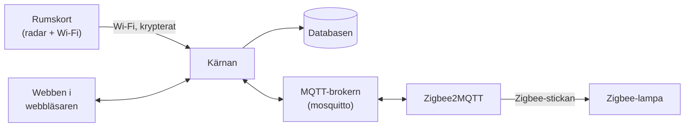

# Installera Homecontrol från noll

Den här guiden tar dig från en tom dator till ett rum där lampan tänds när
du går in. Den är skriven för dig som inte kodar men vill förstå vad som
händer. Varje steg har tre delar:

- **Gör så här:** exakt vad du gör, med kommandon att kopiera.
- **Vad händer?** en kort förklaring av vad som sker bakom kulisserna.
- **Kontrollera:** hur du ser att det fungerade innan du går vidare.

Ta ett steg i taget. Fungerar inte kontrollen: stanna där och läs
felsökningen i den länkade guiden, innan du går vidare.

> Projektet är under arbete och provas just nu i ett rum. Räkna med att
> något kan behöva justeras.

## Innehåll

1. [Översikt: vad är delarna?](#1-översikt-vad-är-delarna)
2. [Förbered Windows](#2-förbered-windows)
3. [Hämta Homecontrol (klona repot)](#3-hämta-homecontrol-klona-repot)
4. [Inställningsfilen .env](#4-inställningsfilen-env)
5. [Starta allt med docker compose](#5-starta-allt-med-docker-compose)
6. [Öppna webben](#6-öppna-webben)
7. [Installera det första rumskortet](#7-installera-det-första-rumskortet)
8. [Koppla Zigbee-lampan](#8-koppla-zigbee-lampan)
9. [Rita rummet på kartan](#9-rita-rummet-på-kartan)
10. [Se närvaro live](#10-se-närvaro-live)
11. [Vad du lärt dig](#vad-du-lärt-dig)
12. [Nästa steg](#nästa-steg)

## 1. Översikt: vad är delarna?

Homecontrol är flera små program som pratar med varandra. Tänk dig ett
litet kontor:

| Del | Vad den gör | Liknelse |
| --- | --- | --- |
| **Rumskortet** (ESP32 med radar) | Sitter i rummet och känner av var människor är. Skickar det över Wi-Fi. | Vakten som tittar ut i rummet. |
| **Kärnan** (`core`) | Tar emot allt från korten, räknar ut var någon är och bestämmer vilka lampor som ska vara tända. | Chefen som fattar besluten. |
| **Databasen** (`db`, PostgreSQL med TimescaleDB) | Sparar hemmets karta och historiken. | Arkivskåpet. |
| **MQTT-brokern** (`mosquitto`) | Skickar meddelanden mellan kärnan och Zigbee2MQTT. | Postkontoret. |
| **Zigbee2MQTT** (`zigbee2mqtt`) | Pratar med lamporna via Zigbee-stickan och översätter till MQTT. | Tolken som kan lampornas språk. |
| **Webben** | Sidan i webbläsaren där du ritar hemmet och ser vad som händer. Kärnan visar den. | Kontorets anslagstavla. |

Några ord som kommer tillbaka:

- **Zigbee** är ett trådlöst språk som smarta lampor talar. Datorn talar
  det inte själv, därför behövs en **Zigbee-sticka** (en USB-sticka med
  radio).
- **MQTT** är ett enkelt sätt för program att skicka korta meddelanden
  till varandra, via en **broker** (ett postkontor) som delar ut dem.
- **Docker** kör varje program i en egen **container**: en låda med
  programmet och allt det behöver. Lådorna startas med ett enda kommando.

Så här hänger det ihop:



Samma sak i text:

```text
Rumskort --Wi-Fi--> Kärnan <--> MQTT-brokern <--> Zigbee2MQTT --Zigbee--> Lampa
                      |  \
                Databasen  Webben (i din webbläsare)
```

Allt körs på din egen dator. Inget skickas till molnet.

## 2. Förbered Windows

**Gör så här:** följ [WINDOWS.md](WINDOWS.md) steg 1–6. Den visar
exakt vilka kommandon du skriver. Har du redan en Linuxdator med Docker kan
du hoppa till steg 3 här.

**Vad händer?**

- **WSL** (Windows Subsystem for Linux) kör Ubuntu, en variant av Linux,
  som en liten dator inuti Windows. Homecontrol är byggt för Linux, ungefär
  som en apparat byggd för ett visst eluttag; WSL är adaptern.
- **Docker** installeras i Ubuntu och kör Homecontrols program i
  containrar. Då behöver du inte installera varje program för sig.
- **Mirrored-läget** gör att Ubuntu delar Windows nätverkskort. Utan det
  skulle rumskorten och mobilen inte hitta Homecontrol i hemnätet.
- **usbipd** lånar ut Zigbee-stickan från Windows till Ubuntu, eftersom
  Ubuntu inte ser USB-enheter av sig själv.

**Kontrollera:** i fönstret Ubuntu ska

```sh
docker run --rm hello-world
```

skriva ut **Hello from Docker!**. Och med Zigbee-stickan inkopplad ska
`ls /dev/serial/by-id/` visa ett långt namn för stickan.

## 3. Hämta Homecontrol (klona repot)

**Gör så här:** i Ubuntu:

```sh
sudo apt install git
git clone https://github.com/YXHFR/Homecontrol.git
cd Homecontrol
```

**Vad händer?** **Git** är ett program som håller reda på alla versioner
av koden. **Klona** betyder att hämta en egen kopia av hela projektet (ett
**repo**, förkortning av repository, "förråd") från GitHub till din dator.
Mappen `Homecontrol` innehåller nu allt: kärnan, webben, firmware och
inställningarna för Docker.

**Kontrollera:**

```sh
ls
```

ska visa bland annat `compose.yaml`, `core`, `web` och `firmware`.

Senare hämtar du nya versioner med `git pull` i samma mapp.

## 4. Inställningsfilen .env

**Gör så här:** i Ubuntu, i mappen `Homecontrol`:

```sh
cp .env.example .env
nano .env
```

Byt ut varje `byt-mig` mot ett eget lösenord, ett nytt för varje rad.
Skapa lösenord med:

```sh
openssl rand -hex 24
```

Kör kommandot en gång för varje lösenord och kopiera svaret. I `nano`
sparar du med Ctrl+O och Enter och stänger med Ctrl+X.

**Vad betyder raderna?**

| Inställning | Betyder |
| --- | --- |
| `POSTGRES_PASSWORD` | Databasens huvudlösenord. Används bara när databasen förbereds. Byt det inte efter första starten. |
| `CORE_DATABASE_PASSWORD` | Kärnans eget lösenord till databasen. Kärnan får bara läsa och skriva, inte ändra databasen. |
| `MQTT_CORE_PASSWORD`, `MQTT_ZIGBEE2MQTT_PASSWORD` | Lösenorden till postkontoret (MQTT), ett för kärnan och ett för Zigbee2MQTT. Var och en får bara läsa de meddelanden den behöver. |
| `ZIGBEE2MQTT_AUTH_TOKEN` | Lösenordet du loggar in med på Zigbee2MQTT:s egen webbsida (steg 8). Spara det. |
| `ESPHOME_SECRET` | Hemligheten som varje rumskorts nyckel räknas fram ur. Skapa den med `openssl rand -hex 32` när du har ett rumskort. **Byt den aldrig sedan**: då måste alla kort installeras om. Tom betyder simuleringsläge, utan riktiga kort. |
| `ZIGBEE_ADAPTER` | Var Zigbee-stickan finns, hela namnet från `ls /dev/serial/by-id/` (se WINDOWS.md steg 6). Tom om du inte har någon sticka än. |

Resten av filen är valfritt och kan stå som det är.

**Vad händer?** `.env` är Homecontrols inställningsfil. Docker läser den
när programmen startar och ger varje program de lösenord det behöver.
Filen finns bara på din dator; den följer aldrig med till GitHub (den är
**gitignorerad**, alltså undantagen från git).

**Kontrollera:**

```sh
grep byt-mig .env
```

ska inte skriva ut något. Gör den det finns rader kvar att fylla i.

## 5. Starta allt med docker compose

**Gör så här:** i Ubuntu, i mappen `Homecontrol`:

```sh
docker compose up -d
```

Första gången hämtas programmen från nätet. Det tar några minuter.

**Vad händer?** `docker compose` läser filen `compose.yaml`, som är en
lista över alla containrar och hur de hänger ihop. `up` startar dem, och
`-d` betyder att de körs i bakgrunden, så att du kan stänga fönstret. De
startar också av sig själva efter en omstart.

| Container | Vad den gör |
| --- | --- |
| `db` | Databasen. Nås bara av kärnan, inte från nätverket. |
| `db-setup` | Förbereder databasens tabeller och kärnans inloggning, och avslutas sedan. Det är meningen att den står som stoppad (**Exited (0)**). |
| `core` | Kärnan och webben, på port 8000. |
| `mosquitto` | MQTT-brokern, på port 1883. |
| `zigbee2mqtt` | Pratar med Zigbee-stickan. Egen webbsida på port 8080. |

En **port** är ett nummer som säger vilket program på datorn du vill
prata med, ungefär som ett rumsnummer i en korridor.

**Kontrollera:**

```sh
docker compose ps
```

`core`, `db`, `mosquitto` och `zigbee2mqtt` ska ha **Up** i kolumnen
STATUS (gärna med **(healthy)**). Står något som **Restarting** eller
saknas: titta i loggen med `docker compose logs core` (byt `core` mot
containerns namn).

## 6. Öppna webben

**Gör så här:** öppna <http://localhost:8000> i webbläsaren på samma
dator. Från mobilen i hemnätet: `http://<datorns adress>:8000` (se
WINDOWS.md steg 7 för hur du hittar adressen).

**Vad händer?** Kärnan är också en liten webbserver. Sidan i webbläsaren
får en ström av händelser från kärnan, så att kartan uppdateras direkt när
något händer, utan att du laddar om.

**Kontrollera:** du ser en karta med ett exempelhem. Så länge
`ESPHOME_SECRET` är tom är **simuleringen** påslagen: Homecontrol låtsas
att det finns rumskort, så att du kan prova allt utan hårdvara.

<!-- AVSNITT 6–10 FORTSÄTTER -->
